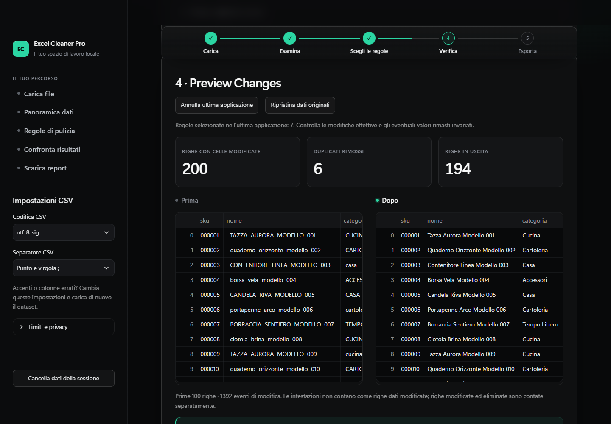

# Excel Cleaner Pro

[Documentazione italiana](README.md) · [Portfolio](PORTFOLIO.md) · [Verification evidence](docs/CATALOG_DEMO_QA.md)

A local Python application for cleaning Excel and CSV tables with explicit rules, before/after previews and an auditable XLSX handover. Built with pandas, openpyxl and Streamlit. No paid AI API, mandatory cloud account or telemetry.

**AI-assisted development:** this project was built with assistance from **Claude (Anthropic)** and **Codex (OpenAI)**, following the project owner's instructions. Assistance covered code, UI, tests and documentation. File processing uses explicit Python rules and does not call AI models at runtime.



## What it does

- Reads CSV with explicit encoding and delimiter settings, or one selected XLSX worksheet.
- Profiles missing values, exact and possible duplicates, column types and indicative anomalies.
- Optionally normalizes whitespace, headings and text case; converts selected numbers and dates using explicit formats.
- Preserves text identifiers, leading zeros, missing values and failed conversions.
- Removes only exact source duplicates after explicit confirmation.
- Exports cleaned data, issues, per-cell changes and metadata; provides one-step undo and reset.
- Forces XLSX strings to literal text and neutralizes formula-like CSV text.

## Synthetic catalog demonstration

The [catalog guide](demo/product_catalog/README.md) documents 200 invented records, 190 distinct SKUs, six exact copies removed and four similar pairs retained. The result has 194 rows. No client engagement, time saving or financial result is represented.

Download or clone the repository, then open `demo/product_catalog/index.html` in a browser for the interactive portfolio page. It uses precomputed examples and does not process new uploads. GitHub displays the HTML source; publishing the repository does not host the Streamlit application.

See the [38-second silent recording](demo/product_catalog/demo_catalogo.webm), [English case study](demo/product_catalog/CASE_STUDY_EN.md) and [proposed service scope](demo/product_catalog/SERVICE_EN.md).

## Run on Windows

Python 3.12 is recommended. From the project directory:

```powershell
py -3.12 -m venv .venv
.\.venv\Scripts\python.exe -m pip install -r requirements.txt
.\.venv\Scripts\python.exe -m streamlit run app.py
```

Open `http://127.0.0.1:8501`. Excel is not required to run the application. `requirements-lock.txt` records the verified Python 3.12 environment.

```powershell
.\.venv\Scripts\python.exe -m pytest -q
```

The latest local suite passed **54 tests**. Separate real-browser checks covered **31 general steps**, **4 catalog steps** and **5 portfolio steps**, including actual downloads. The downloaded catalog workbook was opened read-only in Microsoft Excel and native window captures inspected. These are recorded outcomes, not CI badges or guarantees. [QA report](docs/CATALOG_DEMO_QA.md).

Optional browser checks use an existing Node/Playwright/Chromium installation and never download it automatically. See [browser requirements](docs/BROWSER_QA.md).

## Privacy and boundaries

Original uploads are not saved by the app. XLSX generation uses local temporary XML files, removed after successful export; a crash can leave remnants. Local processing is not exclusively RAM-only processing or forensic erasure.

Limits: 10 MiB input, 50,000 rows, 200 columns and 500,000 cells per selected dataset. No preservation of original workbook styling, formulas, macros or charts; no fuzzy merging, data enrichment, accounting certification or automatic store upload. Decimal conversion uses ordinary floating-point numbers. CSV opening can cause Excel to reinterpret identifiers: prefer XLSX or import identifier columns as text.

This is a portfolio application. Manual acceptance and dataset-specific requirements remain necessary before commercial delivery. See the [Italian manual and troubleshooting guide](README.md) and [manual checklist](docs/MANUAL_QA.md).
