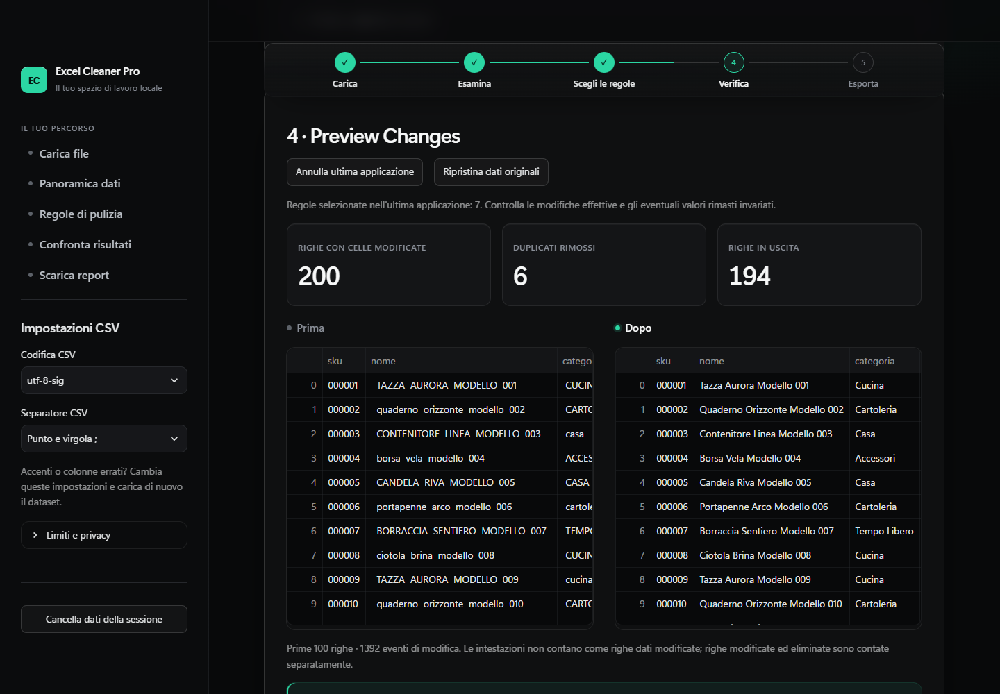

# Excel Cleaner Pro

[English project overview](README.en.md) · [Portfolio e demo](PORTFOLIO.md) · [Verifiche](docs/CATALOG_DEMO_QA.md)

Applicazione locale per pulire e controllare Excel e CSV con regole esplicite, anteprima e tracciabilità. Prototipo da portfolio con test automatici. Il 10 novembre 2026 l'autore ha eseguito il collaudo manuale principale (caricamento, regole, report in Excel, formule, file non validi): esito e prove ancora aperte in `docs/MANUAL_QA.md`. Nessuna promessa di accuratezza universale o certificazione contabile.

**Sviluppo assistito da AI:** il progetto è stato realizzato con l'assistenza di **Claude (Anthropic)** e **Codex (OpenAI)**, su indicazioni dell'autore del progetto. L'assistenza ha riguardato codice, interfaccia, test e documentazione. L'app elabora i file con regole Python esplicite e non contatta modelli AI durante l'utilizzo.



Questo repository contiene codice, documentazione e dati dimostrativi inventati. L'applicazione Streamlit si avvia sul proprio computer. Per esplorare la pagina portfolio interattiva, scarica o clona il progetto e apri `demo/product_catalog/index.html` nel browser; su GitHub il file HTML viene mostrato come codice. Il [video della demo](demo/product_catalog/demo_catalogo.webm) è disponibile come file WebM.

**Nuova demo catalogo prodotti:** apri [la pagina portfolio locale](demo/product_catalog/index.html) con un doppio clic. Include 200 righe sintetiche, confronto interattivo, file prima/dopo, report e un video reale muto di 38 secondi. La [guida](demo/product_catalog/README.md) permette di ripetere le stesse scelte nell'app. Verifica della demo: 54 test Python, 4 passaggi app e 5 passaggi portfolio, oltre ai 31 passaggi browser generali; [evidenze](docs/CATALOG_DEMO_QA.md).

## Requisiti e installazione Windows

L'interfaccia attuale è scura, con accento smeraldo, schede, barra delle fasi e navigazione laterale; si adatta a tablet e telefono. Richiede Streamlit 1.66+ (già indicato in `requirements.txt`). Usa solo caratteri e risorse locali. Verifica dell'8 novembre 2026: 50 test automatici, 31 passaggi browser, installazione offline in un ambiente virtuale nuovo sullo stesso PC e [ispezione delle catture native in Excel](demo/screenshots-excel/README.md). Dettagli e limiti nel [rapporto QA finale](docs/FINAL_QA_REPORT.md). L'accettazione manuale dell'utente e la prova su un altro Windows restano da completare.

Windows 10/11, PowerShell, Python **3.12 o superiore** con pip (consigliato 3.12), almeno 4 GB di RAM disponibili. Installare Python da python.org se `py --version` non funziona. Non serve Excel per eseguire l'app; per la verifica finale di apertura è utile Excel o LibreOffice. Internet serve solo all'installazione delle dipendenze, non all'elaborazione dei file.

Dalla cartella del progetto:

```powershell
py -3.12 -m venv .venv
.\.venv\Scripts\python.exe -m pip install -r requirements.txt
.\.venv\Scripts\python.exe -m streamlit run app.py
```

Aprire `http://127.0.0.1:8501`. Il comando non richiede di attivare lo script PowerShell dell'ambiente virtuale. Se la `.venv` è già presente su questo computer, basta il comando di avvio. Gli ambienti virtuali non sono portabili: su un altro PC ricrearli. `requirements-lock.txt` registra l'ambiente effettivamente verificato; per riprodurlo su Python 3.12 usare `-r requirements-lock.txt` al posto di `requirements.txt`.

## Utilizzo

Se non conosci Python, segui la [prova guidata in pochi minuti](demo/QUICKSTART.md). Per presentare il progetto consulta [PORTFOLIO.md](PORTFOLIO.md); bozze di offerta e candidatura sono collegate lì. Non sono annunci pubblicati. La verifica più recente è in [FINAL_QA_REPORT.md](docs/FINAL_QA_REPORT.md); `VERIFICATION.md` conserva la prima verifica storica.

1. **Upload**: selezionare `.xlsx` o `.csv`. Per Excel scegliere un foglio; per CSV scegliere esplicitamente codifica e separatore nella barra laterale. Premere **Carica dataset**. La prima riga è sempre l'intestazione.
2. **Data Overview**: controllare preview (100 righe), conteggi, tipi, nulli, duplicati e anomalie. Solo campi CSV vuoti diventano nulli: `NA`, `N/A` e `null` restano testo. Intestazioni vuote o duplicate ricevono nomi distinti, con mappatura in Metadata.
3. **Cleaning Rules**: tutte le regole sono inizialmente disattivate. Selezionare compressione degli spazi, intestazioni, case e, per ciascuna colonna, formato numerico o data. Non selezionare conversioni numeriche per codici e CAP. Per eliminare copie esatte servono selezione e conferma separate.
4. **Preview Changes**: applicare le regole, confrontare prima/dopo e leggere controlli e log. Ogni applicazione riparte dalla sorgente, senza accumulare conversioni. **Annulla ultima applicazione** torna alla precedente versione (un livello); **Ripristina dati originali** cancella il risultato. I controlli delle regole rimangono selezionati e richiedono un nuovo invio.
5. **Export**: preparare e scaricare il report `.xlsx` o i dati CSV UTF-8 con BOM e separatore `;`. Le date convertite sono testo ISO, i numeri esportati nel CSV usano punto decimale. Il CSV non include log e metadati: consegnare anche il report quando serve tracciabilità.

Cambiare file, foglio o impostazioni CSV invalida il risultato corrente. **Cancella dati della sessione** rimuove upload, dati e report dalla sessione applicativa. I file scaricati restano nel PC finché non vengono cancellati dall'utente.

## Conversioni conservative

- Italiano: `1.234,56`, `12,50`, `-42,10`; internazionale: `1,234.56`, `12.50`. Simboli EUR/€ e USD/$ ai bordi sono ammessi, ma non viene eseguita conversione di valuta. Raggruppamenti impropri sono segnalati e conservati.
- Stringhe con zeri iniziali e numeri oltre 15 cifre significative non sono convertiti. La conversione a numero usa float per i decimali: non è un motore contabile a precisione arbitraria.
- Date solo con formato esplicito: giorno/mese/anno, mese/giorno/anno, ISO o giorno-mese-anno. `01/02/2025` resta invariata fino alla scelta; date impossibili rimangono testo con un'anomalia. L'output ISO è accettato nelle applicazioni successive per idempotenza.
- Nulli non riempiti. Nessuna riga dubbia eliminata. I duplicati eliminabili sono righe esattamente uguali **nella sorgente**, mantenendo la prima; la normalizzazione non autorizza ulteriori eliminazioni.
- Possibili duplicati: confronto di tutte le colonne dopo normalizzazione spazi/case; non include fuzzy matching, somiglianza semantica o deduplica basata solo su email/codice. Gli outlier numerici IQR sono indicativi e calcolati su valori nativi numerici; non sono una validazione di dominio.

## Report e integrità

Il report ha quattro fogli: **Cleaned_Data**, **Issues**, **Change_Log**, **Metadata**. Tutte le anomalie e gli eventi sono esportati; la UI ne mostra al massimo 1.000. I riferimenti di riga indicano la posizione nella sorgente, intestazione = 1, anche dopo le eliminazioni. Issues descrive problemi nella sorgente e conversioni fallite; le colonne `status` e `note` dicono se ogni segnalazione è stata **risolta** dalle regole scelte, è **da verificare** o è **protetta** all'esportazione. Il foglio Metadata si apre con un `riepilogo` in italiano, seguito dalle impostazioni tecniche.

Change_Log registra per cella regola, prima e dopo; può avere più eventi per la stessa cella. Le righe modificate contano una sola volta le righe con modifiche alle celle, anche se poi eliminate; le eliminazioni sono contate a parte. Cambiare un'intestazione non modifica il conteggio delle righe dati. Metadata contiene timestamp UTC, configurazione, mappatura intestazioni/importazione e risultati reali dei controlli: bilancio delle righe, numero colonne, intestazioni univoche, autorizzazione eliminazioni e ordine. I controlli strutturali non provano che una data o un importo siano corretti per il cliente.

I metadati sono visualizzati a capo. Per JSON molto lunghi, oltre l'altezza massima di una riga Excel, usare la barra della formula o copiare la cella: il valore resta completo. Un report con log estesi può superare i 10 MB del limite di importazione, anche quando la sorgente è accettata.

## Sicurezza e privacy

I controlli includono anche la conservazione delle posizioni dei valori nulli nelle righe mantenute. Metadata registra l'impronta SHA-256 del file importato. Date Excel native contenenti anche un orario o un fuso restano inalterate con una segnalazione se selezionate per conversione; l'app non scarta l'orario. Gli interi nativi oltre 15 cifre vengono esportati in XLSX come testo per evitare perdita di precisione.

Il server ascolta soltanto su `127.0.0.1`; non pubblicarlo su rete o Internet senza un progetto separato di autenticazione e sicurezza. Telemetria Streamlit disabilitata. Nessun account, API AI, connessione cloud o cache condivisa. L'app non salva i file originali caricati: dati e download pronti restano nella sessione. **Durante la creazione dell'XLSX, il writer streaming di openpyxl scrive XML temporanei nella directory temporanea di Windows**, eliminati dopo un'esportazione riuscita. Un arresto anomalo o un errore di sistema può lasciarne residui: non è un'elaborazione esclusivamente in RAM né una cancellazione forense. Evitare dati riservati su PC condivisi; chiudere app/browser al termine. La cancellazione della sessione non elimina i download, eventuali residui temporanei o la memoria del browser. Non sono implementati cifratura, controllo accessi o gestione multiutente.

Le formule XLSX in ingresso sono lette come testo, mai calcolate. Nell'XLSX esportato tutte le stringhe, incluse intestazioni e log, sono forzate a testo. Il CSV aggiunge un apostrofo a stringhe che possono diventare formule (anche precedute da spazi) e quota tutti i campi. Questo altera volutamente la rappresentazione di tali stringhe nel CSV; non sostituisce l'attenzione nell'aprire file non attendibili. Excel può reinterpretare codici e date di un CSV, anche quotato: usare XLSX o importare le colonne come testo. Non abilitare macro, collegamenti esterni o contenuti attivi di file sconosciuti. L'app non modifica gli originali e non esegue le loro formule.

È inclusa `defusedxml` per la protezione del parsing XML dei file XLSX, come raccomandato dalla [documentazione di sicurezza openpyxl](https://openpyxl.readthedocs.io/en/stable/). Non è una scansione antivirus dei documenti.

## Limiti

- 10 MB/file; 50.000 righe, 200 colonne e 500.000 celle per foglio selezionato; archivio XLSX espanso massimo 80 MB e 5.000 elementi. File con dichiarazioni di dimensioni gonfiate possono essere rifiutati. Elaborazione in memoria: log estesi possono consumare molta RAM; evitare più sessioni contemporanee. Nessun benchmark promette tempi massimi.
- Solo `.xlsx` non cifrato e CSV; niente `.xls`, `.xlsm`, PDF, OCR, cartelle batch o fogli uniti. Fogli vuoti rifiutati; file con sola intestazione accettati.
- Importazione di **valori**, non conservazione del workbook: stili originali, celle unite, grafici, macro, formule, convalide, nomi, formattazione e collegamenti non sono ricostruiti. Codici già memorizzati come numeri in Excel non possono recuperare zeri presenti solo nel formato visivo.
- Encoding supportati: UTF-8/BOM, CP1252, Latin-1 e UTF-16; separatori `;`, `,`, tab e `|`. Nessuna deduzione affidabile della codifica: Latin-1 può decodificare caratteri errati senza errore; verificare la preview.
- CSV con righe di lunghezza incoerente o virgolette aperte rifiutati; nessuna correzione automatica. Assenza di righe vuote intermedie consigliata (vengono rifiutate nel CSV).
- Excel limita celle a 32.767 caratteri e report a 1.048.576 righe; esportazioni oltre tali limiti sono bloccate invece di troncare. Per testi incompatibili resta disponibile CSV. Valori decimali destinati a calcoli contabili richiedono verifica professionale separata.

## Test, demo e skill

```powershell
.\.venv\Scripts\python.exe -m pytest -q
.\.venv\Scripts\python.exe -m scripts.generate_demo
```

`tests/` verifica invarianti dati, casi limite, esportazioni e flussi UI con Streamlit AppTest. `demo/` contiene 11 input interamente sintetici, esempio prima/dopo e report. [Guida demo](demo/README.md), [servizio in inglese](demo/FREELANCE_SERVICE_EN.md), [verifica manuale](docs/MANUAL_QA.md), [risultati effettivi](docs/VERIFICATION.md).

Le due skill sono in `.agents/skills/`, con frontmatter `name`/`description`. Sono state lette esplicitamente durante lo sviluppo: non si presume l'attivazione automatica in questa sessione. Per un agente che non le scopra, chiedere di leggere il relativo `SKILL.md`; consultare anche `AGENTS.md`. Per il validatore di skill-creator serve PyYAML (`requirements-dev.txt`), non necessario all'app.

## Risoluzione problemi

La verifica opzionale con browser reale si avvia con `.\.venv\Scripts\python.exe -m scripts.browser_qa` quando Node, Playwright e Chromium sono già disponibili. Non viene installato né scaricato un browser. Requisiti, evidenze e ripetizione sono descritti in [BROWSER_QA.md](docs/BROWSER_QA.md). Non è necessaria per il normale avvio dell'app.

Prova di carico sintetica facoltativa: `.\.venv\Scripts\python.exe -m scripts.benchmark`. Esegue tre casi in processi separati fino a 500.000 celle e verifica conservazione, log e tutti i fogli esportati; salva tempi e picco di memoria in `outputs/benchmark.json`. Può richiedere diversi minuti e non misura browser, Excel o prestazioni garantite.

- `py` non riconosciuto: installare Python dal sito ufficiale, riaprire il terminale oppure usare il percorso completo dell'interprete Python già installato. Non usare la `.venv` di un altro PC.
- `ModuleNotFoundError`: ripetere l'installazione con **lo stesso** `.venv\Scripts\python.exe` usato per avviare l'app.
- Porta occupata: aggiungere `--server.port 8502`; aprire il nuovo indirizzo locale. Arresto: `Ctrl+C` nel terminale.
- CSV in una sola colonna: cambiare separatore e premere Carica dataset. Accenti errati: provare la codifica corretta confrontando l'originale.
- File rifiutato: controllare limiti, prima riga, protezione/cifratura e formato reale; creare una copia con sole colonne/righe necessarie senza sovrascrivere l'originale.
- Opzioni cambiate ma risultato precedente: premere Applica; il pannello configurazione mostra sempre l'ultima applicazione riuscita.

## Contatti

Hai un file Excel o CSV da sistemare, o vuoi informazioni sul servizio? Scrivimi a **[gaetanogennusa@gmail.com](mailto:gaetanogennusa@gmail.com)** oppure tramite il profilo GitHub [GaetanoGennusa](https://github.com/GaetanoGennusa).

Per favore non allegare file con dati personali o riservati al primo messaggio: descrivi prima il problema o invia un esempio con dati inventati, così concordiamo insieme regole, formato e modalità di invio.
